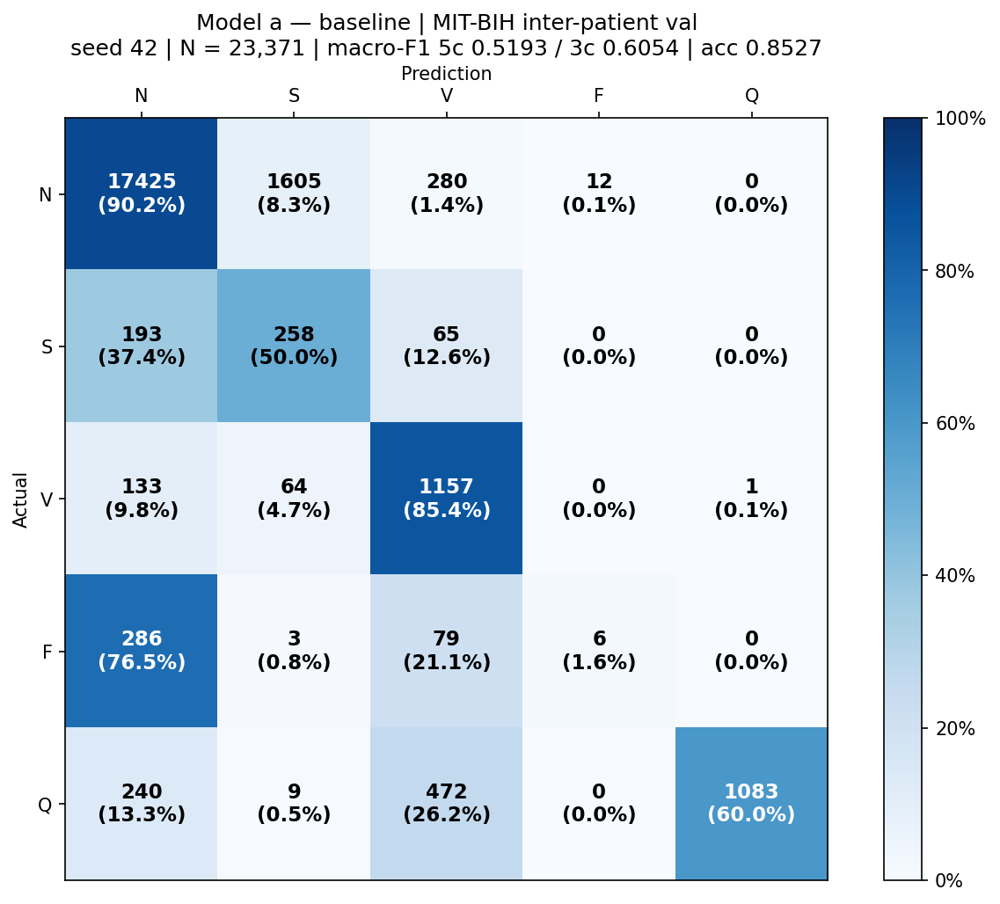
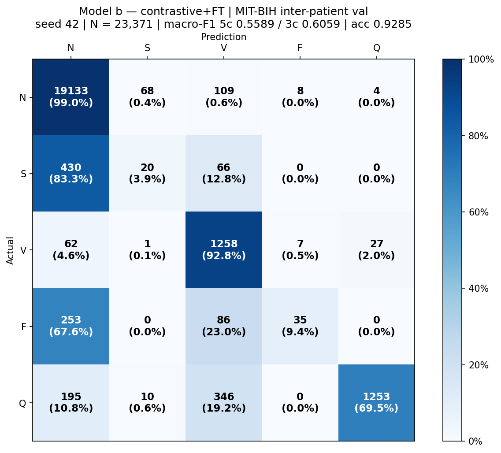
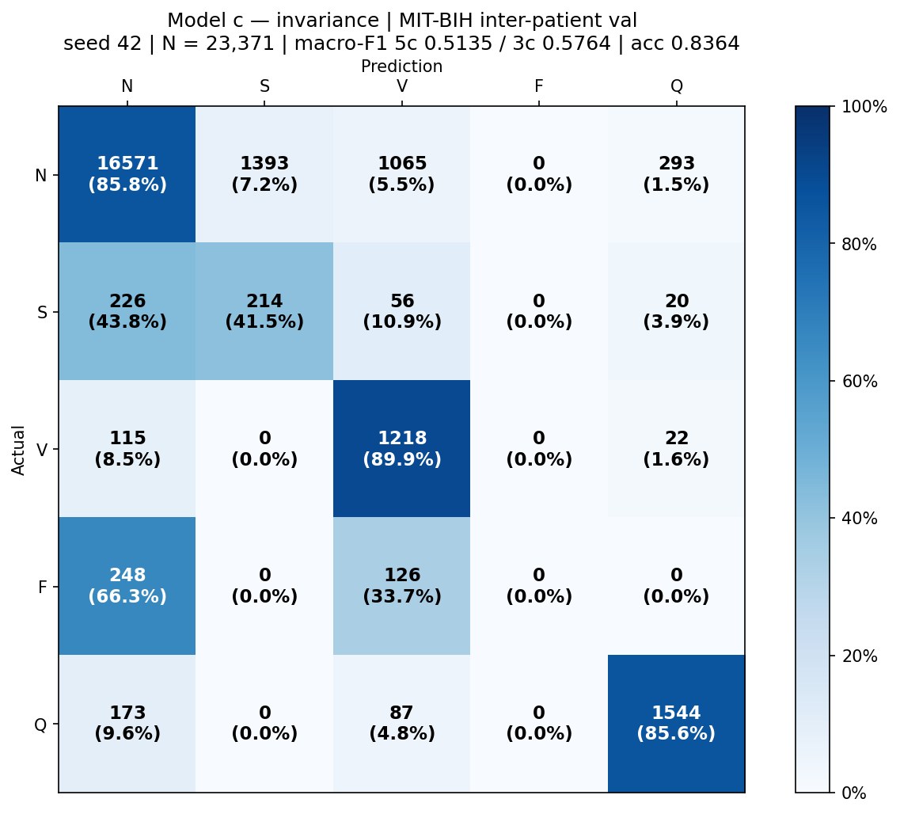
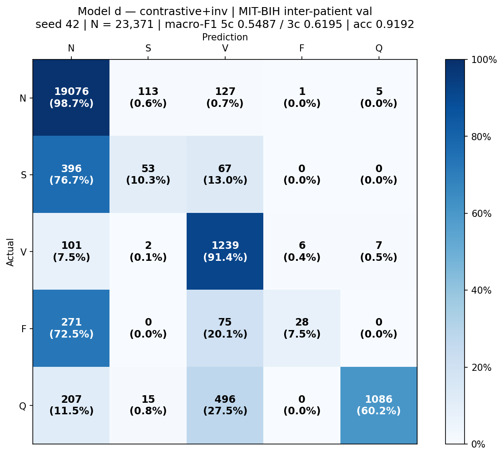
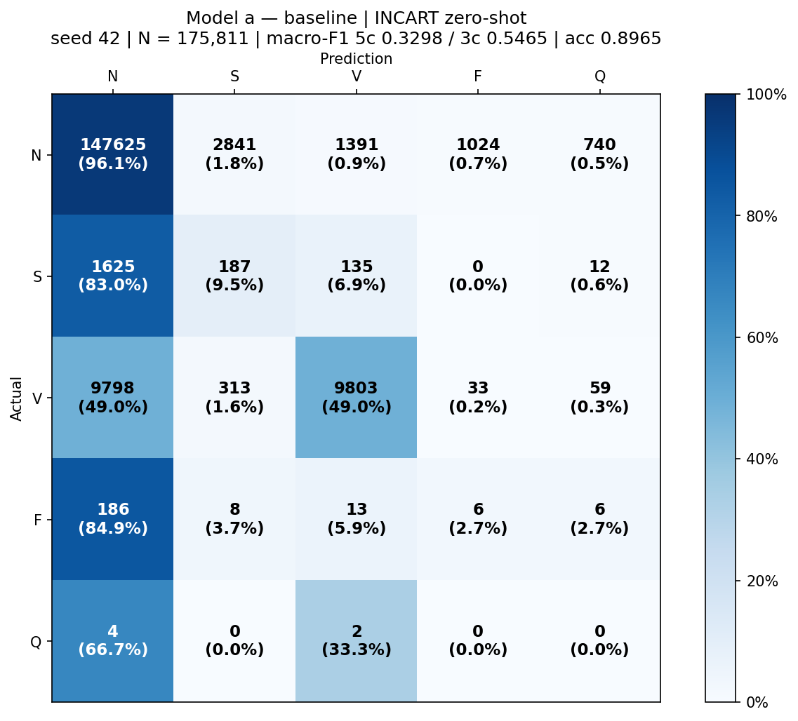
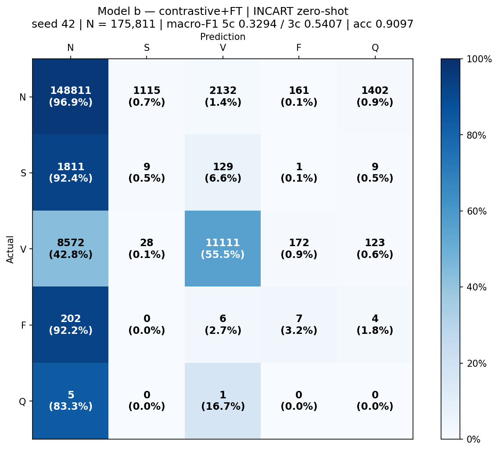
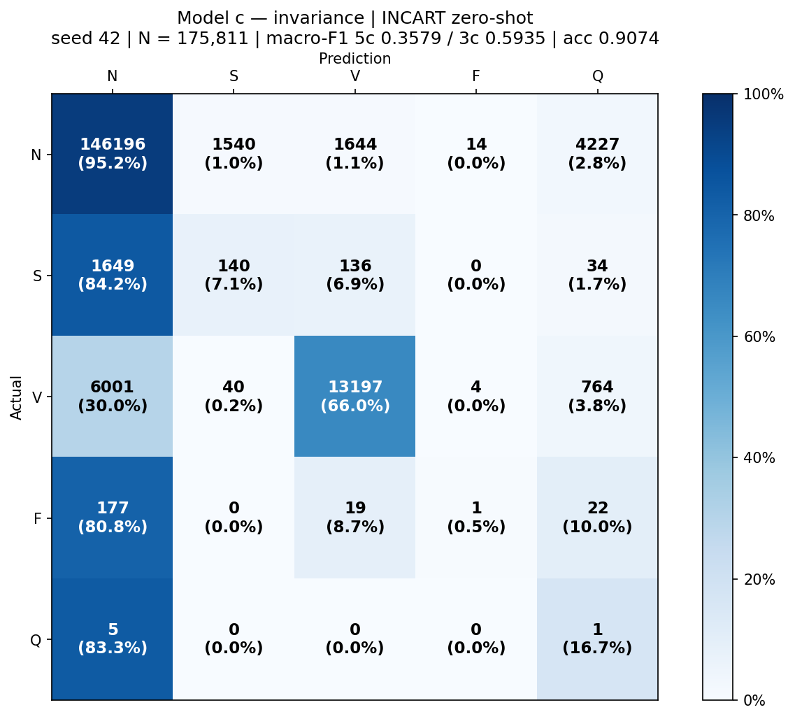
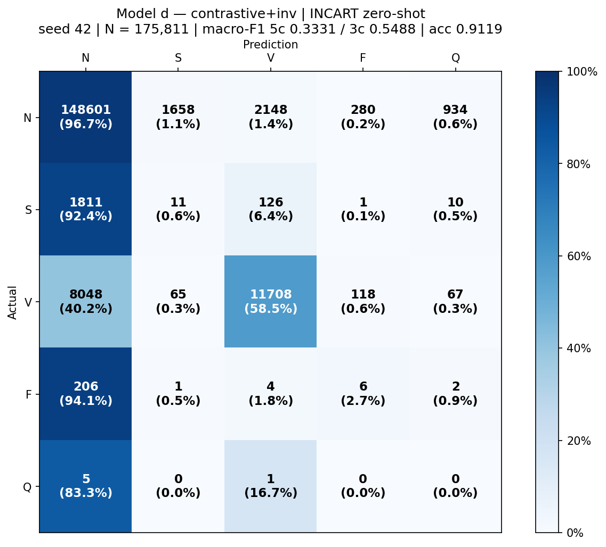
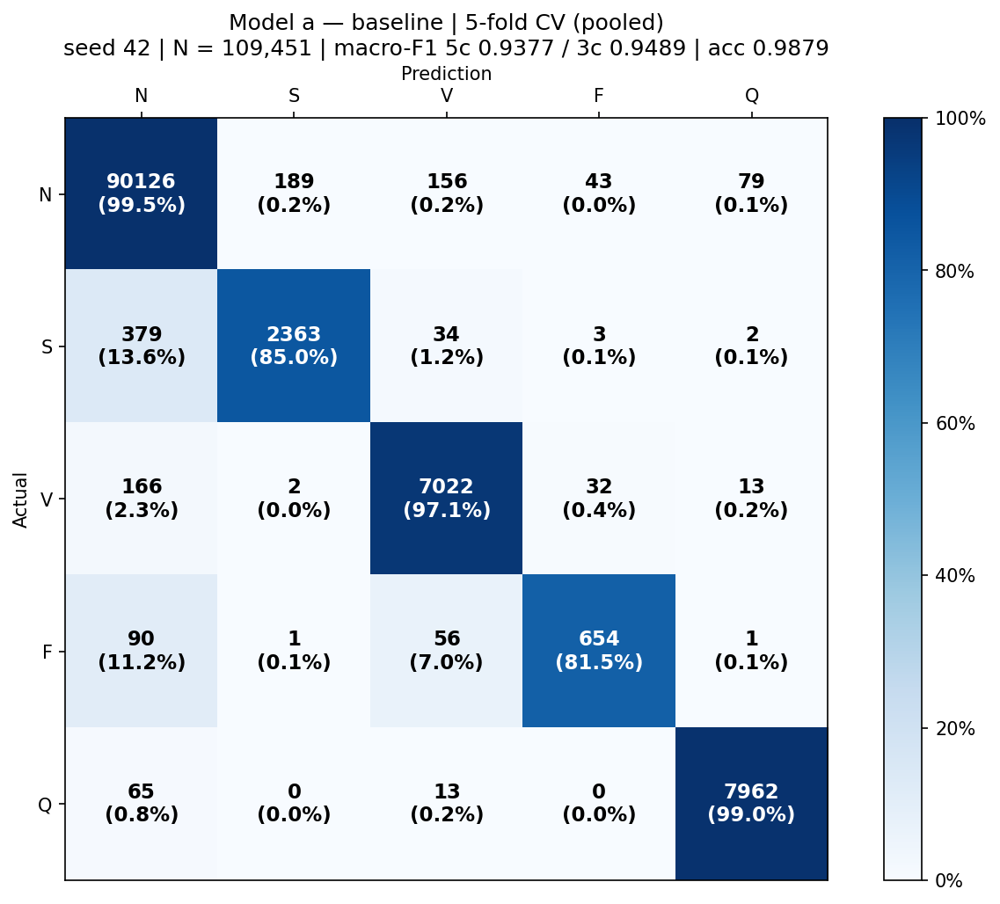
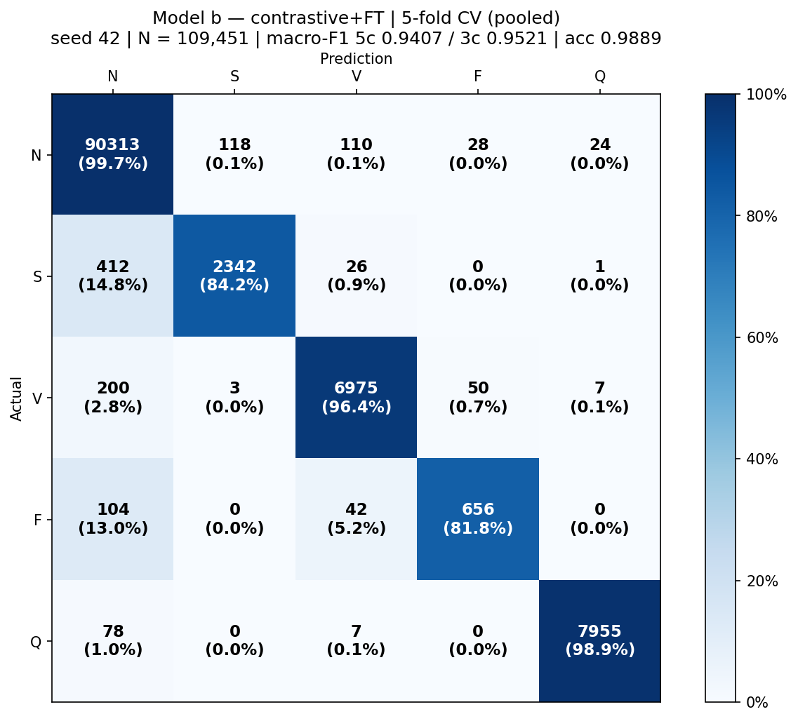

# ECG cross-dataset arrhythmia classification — results pack

Generated by `python code/results_pack.py` from `runs/*/metrics.json` and
`runs/_analysis/confusion_matrices.json`. Nothing here is hand-transcribed.

**The four models.** All share the same `BaselineCNN` (292,005 parameters),
focal loss γ=2.0, no class weights, `MinorityGuaranteedBatchSampler` with an
F floor of 1, batch 64, lr 1e-4, weight decay 1e-5, 5-class-macro checkpoint
selection. **Only two things vary:** weight initialisation and λ_inv.

| model | name | initialisation | λ_inv |
|---|---|---|---|
| **a** | baseline | random | 0.0 |
| **b** | contrastive+FT | pretrained | 0.0 |
| **c** | invariance | random | 0.4 |
| **d** | contrastive+inv | pretrained | 0.4 |

> **Read the three protocols' `n` differently.** Inter-patient and INCART are
> **n = 10 SEEDS** (42–51), so the spread is seed/run variance. 5-fold CV is
> **n = 5 FOLDS with the seed fixed at 42**, so its spread is *partition*
> variance only and is systematically smaller. Quoting a fold-wise sd beside
> a seed-wise sd understates the real uncertainty.

---

## 1. Per-class results

## 1A. Model averages (the summary tables)

### 1A-i. MIT-BIH inter-patient validation fold

Support (number of beats per class, 10 seeds):

| class | N | S | V | F | Q | **total** |
|---|---|---|---|---|---|---|
| beats | 19,322 | 516 | 1,355 | 374 | 1,804 | **23,371** |

**F1 — mean ± sd across 10 seeds**

| model | N | S | V | F | Q | macro (5c) | macro (4c) | macro (3c) |
|---|---|---|---|---|---|---|---|---|
| **a.** baseline | 0.9107 ± 0.0479 | 0.1586 ± 0.0794 | 0.6073 ± 0.0831 | 0.0697 ± 0.0864 | 0.7558 ± 0.1401 | 0.5004 ± 0.0358 | 0.4366 ± 0.0397 | 0.5589 ± 0.0489 |
| **b.** contrastive+FT | 0.9449 ± 0.0282 | 0.1175 ± 0.0942 | 0.6909 ± 0.0776 | 0.0660 ± 0.0880 | 0.7866 ± 0.0702 | 0.5212 ± 0.0238 | 0.4548 ± 0.0262 | 0.5844 ± 0.0352 |
| **c.** invariance | 0.9294 ± 0.0220 | 0.1194 ± 0.0988 | 0.5860 ± 0.0656 | 0.0736 ± 0.0880 | 0.7933 ± 0.0936 | 0.5003 ± 0.0224 | 0.4271 ± 0.0192 | 0.5449 ± 0.0338 |
| **d.** contrastive+inv | 0.9467 ± 0.0193 | 0.1027 ± 0.0664 | 0.7202 ± 0.0774 | 0.0505 ± 0.0499 | 0.8374 ± 0.0915 | 0.5315 ± 0.0339 | 0.4550 ± 0.0310 | 0.5899 ± 0.0349 |

**Precision — mean ± sd across 10 seeds**

| model | N | S | V | F | Q | macro (5c) | macro (4c) | macro (3c) |
|---|---|---|---|---|---|---|---|---|
| **a.** baseline | 0.9411 ± 0.0206 | 0.2073 ± 0.1789 | 0.6321 ± 0.1988 | 0.1136 ± 0.1426 | 0.8345 ± 0.2200 | 0.5457 ± 0.0599 | 0.4735 ± 0.0565 | 0.5935 ± 0.0697 |
| **b.** contrastive+FT | 0.9510 ± 0.0083 | 0.2158 ± 0.2245 | 0.5810 ± 0.1040 | 0.4266 ± 0.3946 | 0.9717 ± 0.0579 | 0.6292 ± 0.0859 | 0.5436 ± 0.1068 | 0.5826 ± 0.0781 |
| **c.** invariance | 0.9465 ± 0.0129 | 0.1026 ± 0.0875 | 0.4806 ± 0.1257 | 0.3333 ± 0.3701 | 0.9668 ± 0.0577 | 0.5660 ± 0.0639 | 0.4658 ± 0.0725 | 0.5099 ± 0.0485 |
| **d.** contrastive+inv | 0.9474 ± 0.0080 | 0.1764 ± 0.1439 | 0.6275 ± 0.1236 | 0.4372 ± 0.4502 | 0.9955 ± 0.0051 | 0.6368 ± 0.1149 | 0.5471 ± 0.1435 | 0.5837 ± 0.0577 |

**Recall — mean ± sd across 10 seeds**

| model | N | S | V | F | Q | macro (5c) | macro (4c) | macro (3c) |
|---|---|---|---|---|---|---|---|---|
| **a.** baseline | 0.8887 ± 0.0977 | 0.2649 ± 0.2005 | 0.6956 ± 0.2135 | 0.1246 ± 0.1890 | 0.7330 ± 0.1613 | 0.5414 ± 0.0629 | 0.4935 ± 0.0843 | 0.6164 ± 0.0940 |
| **b.** contrastive+FT | 0.9399 ± 0.0505 | 0.2083 ± 0.2153 | 0.8773 ± 0.0817 | 0.0390 ± 0.0552 | 0.6731 ± 0.1223 | 0.5476 ± 0.0229 | 0.5162 ± 0.0390 | 0.6752 ± 0.0497 |
| **c.** invariance | 0.9140 ± 0.0428 | 0.1965 ± 0.2021 | 0.8479 ± 0.1683 | 0.0441 ± 0.0537 | 0.6900 ± 0.1482 | 0.5385 ± 0.0420 | 0.5006 ± 0.0326 | 0.6528 ± 0.0461 |
| **d.** contrastive+inv | 0.9471 ± 0.0427 | 0.1266 ± 0.1210 | 0.8711 ± 0.0645 | 0.0433 ± 0.0601 | 0.7314 ± 0.1259 | 0.5439 ± 0.0372 | 0.4970 ± 0.0404 | 0.6482 ± 0.0418 |

### 1A-ii. INCART zero-shot (cross-dataset)

Support (number of beats per class, 10 seeds):

| class | N | S | V | F | Q | **total** |
|---|---|---|---|---|---|---|
| beats | 153,621 | 1,959 | 20,006 | 219 | 6 | **175,811** |

**F1 — mean ± sd across 10 seeds**

| model | N | S | V | F | Q | macro (5c) | macro (4c) | macro (3c) |
|---|---|---|---|---|---|---|---|---|
| **a.** baseline | 0.9240 ± 0.0291 | 0.0459 ± 0.0435 | 0.5761 ± 0.1884 | 0.0040 ± 0.0037 | 0.0005 ± 0.0010 | 0.3101 ± 0.0378 | 0.3875 ± 0.0471 | 0.5153 ± 0.0619 |
| **b.** contrastive+FT | 0.9491 ± 0.0073 | 0.0178 ± 0.0342 | 0.6963 ± 0.0394 | 0.0070 ± 0.0095 | 0.0000 ± 0.0001 | 0.3340 ± 0.0102 | 0.4175 ± 0.0128 | 0.5544 ± 0.0160 |
| **c.** invariance | 0.9473 ± 0.0183 | 0.0286 ± 0.0318 | 0.7197 ± 0.0990 | 0.0039 ± 0.0050 | 0.0005 ± 0.0009 | 0.3400 ± 0.0198 | 0.4249 ± 0.0247 | 0.5652 ± 0.0323 |
| **d.** contrastive+inv | 0.9525 ± 0.0118 | 0.0178 ± 0.0241 | 0.7050 ± 0.0586 | 0.0088 ± 0.0082 | 0.0002 ± 0.0006 | 0.3368 ± 0.0138 | 0.4210 ± 0.0173 | 0.5584 ± 0.0227 |

**Precision — mean ± sd across 10 seeds**

| model | N | S | V | F | Q | macro (5c) | macro (4c) | macro (3c) |
|---|---|---|---|---|---|---|---|---|
| **a.** baseline | 0.9319 ± 0.0265 | 0.0465 ± 0.0265 | 0.9031 ± 0.0628 | 0.0022 ± 0.0021 | 0.0003 ± 0.0005 | 0.3768 ± 0.0106 | 0.4709 ± 0.0132 | 0.6272 ± 0.0179 |
| **b.** contrastive+FT | 0.9420 ± 0.0097 | 0.0175 ± 0.0221 | 0.8113 ± 0.0542 | 0.0048 ± 0.0070 | 0.0000 ± 0.0000 | 0.3551 ± 0.0130 | 0.4439 ± 0.0162 | 0.5903 ± 0.0218 |
| **c.** invariance | 0.9427 ± 0.0152 | 0.0455 ± 0.0385 | 0.8704 ± 0.0468 | 0.0099 ± 0.0190 | 0.0003 ± 0.0005 | 0.3737 ± 0.0126 | 0.4671 ± 0.0158 | 0.6195 ± 0.0195 |
| **d.** contrastive+inv | 0.9401 ± 0.0120 | 0.0202 ± 0.0161 | 0.8603 ± 0.0340 | 0.0234 ± 0.0511 | 0.0001 ± 0.0003 | 0.3688 ± 0.0121 | 0.4610 ± 0.0151 | 0.6068 ± 0.0108 |

**Recall — mean ± sd across 10 seeds**

| model | N | S | V | F | Q | macro (5c) | macro (4c) | macro (3c) |
|---|---|---|---|---|---|---|---|---|
| **a.** baseline | 0.9205 ± 0.0715 | 0.0610 ± 0.0716 | 0.4641 ± 0.2214 | 0.0603 ± 0.0815 | 0.1333 ± 0.1054 | 0.3278 ± 0.0611 | 0.3765 ± 0.0579 | 0.4819 ± 0.0633 |
| **b.** contrastive+FT | 0.9565 ± 0.0172 | 0.0344 ± 0.0843 | 0.6187 ± 0.0854 | 0.0169 ± 0.0214 | 0.0167 ± 0.0527 | 0.3286 ± 0.0201 | 0.4066 ± 0.0272 | 0.5365 ± 0.0325 |
| **c.** invariance | 0.9524 ± 0.0291 | 0.0524 ± 0.1110 | 0.6308 ± 0.1306 | 0.0210 ± 0.0379 | 0.0667 ± 0.0861 | 0.3446 ± 0.0216 | 0.4141 ± 0.0179 | 0.5452 ± 0.0165 |
| **d.** contrastive+inv | 0.9658 ± 0.0288 | 0.0270 ± 0.0597 | 0.6052 ± 0.0965 | 0.0247 ± 0.0366 | 0.0167 ± 0.0527 | 0.3279 ± 0.0218 | 0.4057 ± 0.0303 | 0.5327 ± 0.0346 |

### 1A-iii. 5-fold CV — MIT-BIH validation (pooled protocol)

Support (number of beats per class, 5 folds):

| class | N | S | V | F | Q | **total** |
|---|---|---|---|---|---|---|
| beats | 90,593 | 2,781 | 7,235 | 802 | 8,040 | **109,451** |

**F1 — mean ± sd across 5 folds**

| model | N | S | V | F | Q | macro (5c) | macro (4c) | macro (3c) |
|---|---|---|---|---|---|---|---|---|
| **a.** baseline | 0.9936 ± 0.0010 | 0.8847 ± 0.0114 | 0.9674 ± 0.0046 | 0.8548 ± 0.0158 | 0.9893 ± 0.0050 | 0.9380 ± 0.0065 | 0.9251 ± 0.0071 | 0.9486 ± 0.0054 |
| **b.** contrastive+FT | 0.9941 ± 0.0007 | 0.8929 ± 0.0131 | 0.9691 ± 0.0034 | 0.8541 ± 0.0045 | 0.9927 ± 0.0021 | 0.9406 ± 0.0031 | 0.9276 ± 0.0036 | 0.9520 ± 0.0054 |
| **c.** invariance | 0.9932 ± 0.0006 | 0.8751 ± 0.0258 | 0.9652 ± 0.0019 | 0.8515 ± 0.0146 | 0.9908 ± 0.0025 | 0.9352 ± 0.0058 | 0.9213 ± 0.0071 | 0.9445 ± 0.0087 |
| **d.** contrastive+inv | 0.9939 ± 0.0005 | 0.8910 ± 0.0098 | 0.9691 ± 0.0012 | 0.8589 ± 0.0093 | 0.9929 ± 0.0009 | 0.9411 ± 0.0023 | 0.9282 ± 0.0030 | 0.9513 ± 0.0036 |

**Precision — mean ± sd across 5 folds**

| model | N | S | V | F | Q | macro (5c) | macro (4c) | macro (3c) |
|---|---|---|---|---|---|---|---|---|
| **a.** baseline | 0.9923 ± 0.0012 | 0.9236 ± 0.0121 | 0.9641 ± 0.0086 | 0.8959 ± 0.0324 | 0.9885 ± 0.0139 | 0.9529 ± 0.0106 | 0.9440 ± 0.0105 | 0.9600 ± 0.0050 |
| **b.** contrastive+FT | 0.9913 ± 0.0013 | 0.9511 ± 0.0152 | 0.9740 ± 0.0041 | 0.8946 ± 0.0201 | 0.9960 ± 0.0019 | 0.9614 ± 0.0070 | 0.9527 ± 0.0088 | 0.9721 ± 0.0059 |
| **c.** invariance | 0.9893 ± 0.0020 | 0.9590 ± 0.0158 | 0.9734 ± 0.0119 | 0.9104 ± 0.0319 | 0.9959 ± 0.0034 | 0.9656 ± 0.0074 | 0.9580 ± 0.0095 | 0.9739 ± 0.0065 |
| **d.** contrastive+inv | 0.9924 ± 0.0014 | 0.9190 ± 0.0482 | 0.9682 ± 0.0083 | 0.9093 ± 0.0386 | 0.9964 ± 0.0026 | 0.9571 ± 0.0113 | 0.9472 ± 0.0142 | 0.9599 ± 0.0176 |

**Recall — mean ± sd across 5 folds**

| model | N | S | V | F | Q | macro (5c) | macro (4c) | macro (3c) |
|---|---|---|---|---|---|---|---|---|
| **a.** baseline | 0.9948 ± 0.0019 | 0.8493 ± 0.0242 | 0.9708 ± 0.0040 | 0.8179 ± 0.0165 | 0.9903 ± 0.0065 | 0.9246 ± 0.0077 | 0.9082 ± 0.0094 | 0.9383 ± 0.0094 |
| **b.** contrastive+FT | 0.9969 ± 0.0006 | 0.8418 ± 0.0202 | 0.9642 ± 0.0058 | 0.8179 ± 0.0239 | 0.9894 ± 0.0040 | 0.9220 ± 0.0050 | 0.9052 ± 0.0061 | 0.9343 ± 0.0083 |
| **c.** invariance | 0.9973 ± 0.0011 | 0.8065 ± 0.0517 | 0.9574 ± 0.0121 | 0.8005 ± 0.0195 | 0.9858 ± 0.0041 | 0.9095 ± 0.0111 | 0.8904 ± 0.0135 | 0.9204 ± 0.0168 |
| **d.** contrastive+inv | 0.9954 ± 0.0023 | 0.8670 ± 0.0277 | 0.9700 ± 0.0071 | 0.8154 ± 0.0288 | 0.9896 ± 0.0033 | 0.9275 ± 0.0072 | 0.9119 ± 0.0084 | 0.9441 ± 0.0104 |

### 1A-iv. 5-fold CV — INCART zero-shot

Support (number of beats per class, 5 folds):

| class | N | S | V | F | Q | **total** |
|---|---|---|---|---|---|---|
| beats | 153,621 | 1,959 | 20,006 | 219 | 6 | **175,811** |

**F1 — mean ± sd across 5 folds**

| model | N | S | V | F | Q | macro (5c) | macro (4c) | macro (3c) |
|---|---|---|---|---|---|---|---|---|
| **a.** baseline | 0.9225 ± 0.0088 | 0.0875 ± 0.0413 | 0.7290 ± 0.0257 | 0.0218 ± 0.0017 | 0.0000 ± 0.0000 | 0.3522 ± 0.0110 | 0.4402 ± 0.0138 | 0.5796 ± 0.0183 |
| **b.** contrastive+FT | 0.9457 ± 0.0097 | 0.1202 ± 0.0680 | 0.7315 ± 0.0364 | 0.0500 ± 0.0034 | 0.0005 ± 0.0012 | 0.3696 ± 0.0182 | 0.4619 ± 0.0225 | 0.5991 ± 0.0298 |
| **c.** invariance | 0.9468 ± 0.0122 | 0.0784 ± 0.0606 | 0.7566 ± 0.0361 | 0.0333 ± 0.0092 | 0.0000 ± 0.0000 | 0.3630 ± 0.0168 | 0.4538 ± 0.0209 | 0.5940 ± 0.0256 |
| **d.** contrastive+inv | 0.9387 ± 0.0141 | 0.1594 ± 0.0349 | 0.7252 ± 0.0209 | 0.0644 ± 0.0202 | 0.0002 ± 0.0004 | 0.3776 ± 0.0065 | 0.4719 ± 0.0082 | 0.6078 ± 0.0164 |

**Precision — mean ± sd across 5 folds**

| model | N | S | V | F | Q | macro (5c) | macro (4c) | macro (3c) |
|---|---|---|---|---|---|---|---|---|
| **a.** baseline | 0.9663 ± 0.0033 | 0.0793 ± 0.0368 | 0.6634 ± 0.0398 | 0.0114 ± 0.0009 | 0.0000 ± 0.0000 | 0.3441 ± 0.0127 | 0.4301 ± 0.0158 | 0.5697 ± 0.0211 |
| **b.** contrastive+FT | 0.9632 ± 0.0018 | 0.1475 ± 0.0650 | 0.6852 ± 0.0671 | 0.0276 ± 0.0021 | 0.0003 ± 0.0006 | 0.3648 ± 0.0191 | 0.4559 ± 0.0238 | 0.5986 ± 0.0316 |
| **c.** invariance | 0.9595 ± 0.0055 | 0.1106 ± 0.0380 | 0.7563 ± 0.0915 | 0.0181 ± 0.0055 | 0.0000 ± 0.0000 | 0.3689 ± 0.0202 | 0.4611 ± 0.0252 | 0.6088 ± 0.0326 |
| **d.** contrastive+inv | 0.9680 ± 0.0049 | 0.1574 ± 0.0628 | 0.6571 ± 0.0677 | 0.0379 ± 0.0153 | 0.0001 ± 0.0002 | 0.3641 ± 0.0174 | 0.4551 ± 0.0218 | 0.5942 ± 0.0326 |

**Recall — mean ± sd across 5 folds**

| model | N | S | V | F | Q | macro (5c) | macro (4c) | macro (3c) |
|---|---|---|---|---|---|---|---|---|
| **a.** baseline | 0.8826 ± 0.0180 | 0.1040 ± 0.0537 | 0.8105 ± 0.0269 | 0.2594 ± 0.0127 | 0.0000 ± 0.0000 | 0.4113 ± 0.0104 | 0.5141 ± 0.0130 | 0.5991 ± 0.0178 |
| **b.** contrastive+FT | 0.9289 ± 0.0182 | 0.1063 ± 0.0689 | 0.7890 ± 0.0188 | 0.2676 ± 0.0436 | 0.0333 ± 0.0745 | 0.4250 ± 0.0220 | 0.5229 ± 0.0146 | 0.6081 ± 0.0222 |
| **c.** invariance | 0.9349 ± 0.0267 | 0.0697 ± 0.0612 | 0.7659 ± 0.0505 | 0.2374 ± 0.0351 | 0.0000 ± 0.0000 | 0.4016 ± 0.0088 | 0.5020 ± 0.0110 | 0.5902 ± 0.0206 |
| **d.** contrastive+inv | 0.9117 ± 0.0303 | 0.1941 ± 0.0562 | 0.8183 ± 0.0486 | 0.2566 ± 0.0376 | 0.0333 ± 0.0745 | 0.4428 ± 0.0190 | 0.5452 ± 0.0077 | 0.6414 ± 0.0216 |

## 1B. Per-seed / per-fold detail

### 1B-i. MIT-BIH inter-patient validation — per-seed F1

Validation fold = 23,371 beats from 10 held-out records; training = 86,080 beats from 38 records.

**Model a — baseline** (init=random, λ_inv=0.0, tag `focal_sampler`, n=10)

| seed / fold | F1(N) | F1(S) | F1(V) | F1(F) | F1(Q) | macro-F1 (5c) | 4c | 3c | acc-proxy epochs |
|---|---|---|---|---|---|---|---|---|---|
| 42 | 0.9272 | 0.2109 | 0.6798 | 0.0306 | 0.7513 | **0.5200** | 0.4621 | 0.6059 | 15 |
| 43 | 0.8361 | 0.1744 | 0.5450 | 0.1187 | 0.8711 | **0.5090** | 0.4185 | 0.5185 | 10 |
| 44 | 0.8810 | 0.0963 | 0.5399 | 0.1737 | 0.4982 | **0.4378** | 0.4227 | 0.5057 | 12 |
| 45 | 0.9114 | 0.1110 | 0.4419 | 0.0000 | 0.9011 | **0.4731** | 0.3661 | 0.4881 | 14 |
| 46 | 0.9496 | 0.1704 | 0.5948 | 0.2497 | 0.6292 | **0.5187** | 0.4911 | 0.5716 | 12 |
| 47 | 0.9276 | 0.3051 | 0.6285 | 0.0000 | 0.6259 | **0.4974** | 0.4653 | 0.6204 | 11 |
| 48 | 0.8245 | 0.1696 | 0.6112 | 0.0473 | 0.6822 | **0.4670** | 0.4132 | 0.5351 | 11 |
| 49 | 0.9540 | 0.0000 | 0.6502 | 0.0000 | 0.8582 | **0.4925** | 0.4010 | 0.5347 | 14 |
| 50 | 0.9415 | 0.1859 | 0.7394 | 0.0767 | 0.8899 | **0.5667** | 0.4859 | 0.6222 | 10 |
| 51 | 0.9540 | 0.1626 | 0.6429 | 0.0000 | 0.8508 | **0.5220** | 0.4399 | 0.5865 | 10 |
| **mean ± sd** | 0.9107 ± 0.0479 | 0.1586 ± 0.0794 | 0.6073 ± 0.0831 | 0.0697 ± 0.0864 | 0.7558 ± 0.1401 | **0.5004 ± 0.0358** | 0.4366 ± 0.0397 | 0.5589 ± 0.0489 | |

**Model b — contrastive+FT** (init=pretrained, λ_inv=0.0, tag `pretrained_focal_sampler`, n=10)

| seed / fold | F1(N) | F1(S) | F1(V) | F1(F) | F1(Q) | macro-F1 (5c) | 4c | 3c | acc-proxy epochs |
|---|---|---|---|---|---|---|---|---|---|
| 42 | 0.9713 | 0.0651 | 0.7803 | 0.1651 | 0.8104 | **0.5584** | 0.4955 | 0.6056 | 10 |
| 43 | 0.9443 | 0.2353 | 0.7100 | 0.0159 | 0.8646 | **0.5540** | 0.4764 | 0.6299 | 10 |
| 44 | 0.9681 | 0.0412 | 0.7793 | 0.0000 | 0.8314 | **0.5240** | 0.4471 | 0.5962 | 14 |
| 45 | 0.9518 | 0.2133 | 0.7401 | 0.0230 | 0.7292 | **0.5315** | 0.4821 | 0.6351 | 16 |
| 46 | 0.8767 | 0.1412 | 0.6417 | 0.0092 | 0.7157 | **0.4769** | 0.4172 | 0.5532 | 19 |
| 47 | 0.9244 | 0.2262 | 0.5922 | 0.0952 | 0.7028 | **0.5082** | 0.4595 | 0.5809 | 13 |
| 48 | 0.9418 | 0.1900 | 0.6462 | 0.0686 | 0.7703 | **0.5234** | 0.4616 | 0.5926 | 13 |
| 49 | 0.9688 | 0.0000 | 0.7435 | 0.0159 | 0.7915 | **0.5039** | 0.4321 | 0.5708 | 10 |
| 50 | 0.9422 | 0.0626 | 0.5569 | 0.2667 | 0.7329 | **0.5123** | 0.4571 | 0.5206 | 10 |
| 51 | 0.9596 | 0.0000 | 0.7192 | 0.0000 | 0.9177 | **0.5193** | 0.4197 | 0.5596 | 10 |
| **mean ± sd** | 0.9449 ± 0.0282 | 0.1175 ± 0.0942 | 0.6909 ± 0.0776 | 0.0660 ± 0.0880 | 0.7866 ± 0.0702 | **0.5212 ± 0.0238** | 0.4548 ± 0.0262 | 0.5844 ± 0.0352 | |

**Model c — invariance** (init=random, λ_inv=0.4, tag `focal_inv04_sampler`, n=10)

| seed / fold | F1(N) | F1(S) | F1(V) | F1(F) | F1(Q) | macro-F1 (5c) | 4c | 3c | acc-proxy epochs |
|---|---|---|---|---|---|---|---|---|---|
| 42 | 0.9041 | 0.2010 | 0.6237 | 0.0000 | 0.8387 | **0.5135** | 0.4322 | 0.5763 | 13 |
| 43 | 0.9259 | 0.2506 | 0.5297 | 0.1260 | 0.7769 | **0.5218** | 0.4580 | 0.5687 | 10 |
| 44 | 0.9353 | 0.2278 | 0.5235 | 0.0000 | 0.5942 | **0.4562** | 0.4217 | 0.5622 | 14 |
| 45 | 0.9572 | 0.1245 | 0.7058 | 0.0053 | 0.7651 | **0.5116** | 0.4482 | 0.5959 | 14 |
| 46 | 0.8918 | 0.1750 | 0.5139 | 0.0000 | 0.8795 | **0.4920** | 0.3952 | 0.5269 | 18 |
| 47 | 0.9377 | 0.0526 | 0.6447 | 0.0000 | 0.8663 | **0.5003** | 0.4088 | 0.5450 | 12 |
| 48 | 0.9399 | 0.0000 | 0.5299 | 0.1610 | 0.7331 | **0.4728** | 0.4077 | 0.4899 | 10 |
| 49 | 0.9536 | 0.0000 | 0.6388 | 0.1395 | 0.8000 | **0.5064** | 0.4330 | 0.5308 | 10 |
| 50 | 0.9430 | 0.0000 | 0.5522 | 0.2424 | 0.7517 | **0.4979** | 0.4344 | 0.4984 | 10 |
| 51 | 0.9059 | 0.1622 | 0.5976 | 0.0619 | 0.9272 | **0.5310** | 0.4319 | 0.5553 | 16 |
| **mean ± sd** | 0.9294 ± 0.0220 | 0.1194 ± 0.0988 | 0.5860 ± 0.0656 | 0.0736 ± 0.0880 | 0.7933 ± 0.0936 | **0.5003 ± 0.0224** | 0.4271 ± 0.0192 | 0.5449 ± 0.0338 | |

**Model d — contrastive+inv** (init=pretrained, λ_inv=0.4, tag `pretrained_inv04_sampler`, n=10)

| seed / fold | F1(N) | F1(S) | F1(V) | F1(F) | F1(Q) | macro-F1 (5c) | 4c | 3c | acc-proxy epochs |
|---|---|---|---|---|---|---|---|---|---|
| 42 | 0.9689 | 0.1516 | 0.7367 | 0.1366 | 0.7493 | **0.5486** | 0.4985 | 0.6191 | 10 |
| 43 | 0.9258 | 0.2042 | 0.7384 | 0.1004 | 0.7894 | **0.5517** | 0.4922 | 0.6228 | 14 |
| 44 | 0.9299 | 0.1538 | 0.6227 | 0.0398 | 0.8434 | **0.5179** | 0.4366 | 0.5688 | 14 |
| 45 | 0.9600 | 0.1596 | 0.8173 | 0.0000 | 0.8790 | **0.5632** | 0.4842 | 0.6456 | 12 |
| 46 | 0.9080 | 0.1316 | 0.7155 | 0.0547 | 0.8928 | **0.5405** | 0.4524 | 0.5850 | 25 |
| 47 | 0.9500 | 0.0575 | 0.6055 | 0.0000 | 0.6293 | **0.4485** | 0.4033 | 0.5377 | 10 |
| 48 | 0.9498 | 0.0854 | 0.6560 | 0.0159 | 0.8783 | **0.5171** | 0.4268 | 0.5637 | 10 |
| 49 | 0.9520 | 0.0291 | 0.7475 | 0.0156 | 0.8721 | **0.5233** | 0.4361 | 0.5762 | 10 |
| 50 | 0.9597 | 0.0039 | 0.7145 | 0.1159 | 0.9026 | **0.5393** | 0.4485 | 0.5594 | 10 |
| 51 | 0.9628 | 0.0506 | 0.8478 | 0.0264 | 0.9373 | **0.5650** | 0.4719 | 0.6204 | 16 |
| **mean ± sd** | 0.9467 ± 0.0193 | 0.1027 ± 0.0664 | 0.7202 ± 0.0774 | 0.0505 ± 0.0499 | 0.8374 ± 0.0915 | **0.5315 ± 0.0339** | 0.4550 ± 0.0310 | 0.5899 ± 0.0349 | |

### 1B-ii. INCART zero-shot — per-seed F1

175,811 beats from 75 records, never trained on. F1(Q)≈0 by construction: INCART contains 6 Q beats.

**Model a — baseline** (init=random, λ_inv=0.0, tag `focal_sampler`, n=10)

| seed / fold | F1(N) | F1(S) | F1(V) | F1(F) | F1(Q) | macro-F1 (5c) | 4c | 3c | acc-proxy epochs |
|---|---|---|---|---|---|---|---|---|---|
| 42 | 0.9438 | 0.0705 | 0.6245 | 0.0093 | 0.0000 | **0.3296** | 0.4120 | 0.5463 | 15 |
| 43 | 0.8916 | 0.0653 | 0.7561 | 0.0051 | 0.0001 | **0.3437** | 0.4295 | 0.5710 | 10 |
| 44 | 0.9030 | 0.0029 | 0.7189 | 0.0062 | 0.0002 | **0.3263** | 0.4078 | 0.5416 | 12 |
| 45 | 0.9232 | 0.1442 | 0.3892 | 0.0000 | 0.0004 | **0.2914** | 0.3641 | 0.4855 | 14 |
| 46 | 0.9490 | 0.0020 | 0.4191 | 0.0043 | 0.0000 | **0.2749** | 0.3436 | 0.4567 | 12 |
| 47 | 0.9143 | 0.0376 | 0.3805 | 0.0000 | 0.0001 | **0.2665** | 0.3331 | 0.4441 | 11 |
| 48 | 0.8691 | 0.0520 | 0.8015 | 0.0077 | 0.0002 | **0.3461** | 0.4326 | 0.5742 | 11 |
| 49 | 0.9378 | 0.0000 | 0.2864 | 0.0000 | 0.0000 | **0.2448** | 0.3061 | 0.4081 | 14 |
| 50 | 0.9561 | 0.0560 | 0.7400 | 0.0078 | 0.0031 | **0.3526** | 0.4400 | 0.5840 | 10 |
| 51 | 0.9519 | 0.0281 | 0.6452 | 0.0000 | 0.0012 | **0.3253** | 0.4063 | 0.5417 | 10 |
| **mean ± sd** | 0.9240 ± 0.0291 | 0.0459 ± 0.0435 | 0.5761 ± 0.1884 | 0.0040 ± 0.0037 | 0.0005 ± 0.0010 | **0.3101 ± 0.0378** | 0.3875 ± 0.0471 | 0.5153 ± 0.0619 | |

**Model b — contrastive+FT** (init=pretrained, λ_inv=0.0, tag `pretrained_focal_sampler`, n=10)

| seed / fold | F1(N) | F1(S) | F1(V) | F1(F) | F1(Q) | macro-F1 (5c) | 4c | 3c | acc-proxy epochs |
|---|---|---|---|---|---|---|---|---|---|
| 42 | 0.9508 | 0.0051 | 0.6652 | 0.0249 | 0.0000 | **0.3292** | 0.4115 | 0.5404 | 10 |
| 43 | 0.9477 | 0.0080 | 0.6353 | 0.0000 | 0.0000 | **0.3182** | 0.3977 | 0.5303 | 10 |
| 44 | 0.9430 | 0.0020 | 0.6948 | 0.0000 | 0.0002 | **0.3280** | 0.4099 | 0.5466 | 14 |
| 45 | 0.9484 | 0.0144 | 0.6728 | 0.0051 | 0.0000 | **0.3282** | 0.4102 | 0.5452 | 16 |
| 46 | 0.9387 | 0.1132 | 0.6810 | 0.0031 | 0.0000 | **0.3472** | 0.4340 | 0.5776 | 19 |
| 47 | 0.9459 | 0.0191 | 0.7369 | 0.0060 | 0.0000 | **0.3416** | 0.4270 | 0.5673 | 13 |
| 48 | 0.9420 | 0.0152 | 0.7229 | 0.0071 | 0.0000 | **0.3374** | 0.4218 | 0.5600 | 13 |
| 49 | 0.9590 | 0.0000 | 0.6724 | 0.0000 | 0.0000 | **0.3263** | 0.4078 | 0.5438 | 10 |
| 50 | 0.9614 | 0.0009 | 0.7689 | 0.0237 | 0.0000 | **0.3510** | 0.4387 | 0.5771 | 10 |
| 51 | 0.9538 | 0.0000 | 0.7128 | 0.0000 | 0.0000 | **0.3333** | 0.4166 | 0.5555 | 10 |
| **mean ± sd** | 0.9491 ± 0.0073 | 0.0178 ± 0.0342 | 0.6963 ± 0.0394 | 0.0070 ± 0.0095 | 0.0000 ± 0.0001 | **0.3340 ± 0.0102** | 0.4175 ± 0.0128 | 0.5544 ± 0.0160 | |

**Model c — invariance** (init=random, λ_inv=0.4, tag `focal_inv04_sampler`, n=10)

| seed / fold | F1(N) | F1(S) | F1(V) | F1(F) | F1(Q) | macro-F1 (5c) | 4c | 3c | acc-proxy epochs |
|---|---|---|---|---|---|---|---|---|---|
| 42 | 0.9504 | 0.0755 | 0.7540 | 0.0084 | 0.0004 | **0.3577** | 0.4471 | 0.5933 | 13 |
| 43 | 0.9354 | 0.0345 | 0.7685 | 0.0066 | 0.0000 | **0.3490** | 0.4363 | 0.5795 | 10 |
| 44 | 0.9604 | 0.0112 | 0.7564 | 0.0000 | 0.0026 | **0.3461** | 0.4320 | 0.5760 | 14 |
| 45 | 0.9627 | 0.0507 | 0.7225 | 0.0000 | 0.0000 | **0.3472** | 0.4340 | 0.5786 | 14 |
| 46 | 0.9020 | 0.0854 | 0.4465 | 0.0000 | 0.0000 | **0.2868** | 0.3585 | 0.4779 | 18 |
| 47 | 0.9481 | 0.0103 | 0.7571 | 0.0000 | 0.0000 | **0.3431** | 0.4289 | 0.5718 | 12 |
| 48 | 0.9645 | 0.0000 | 0.7259 | 0.0000 | 0.0000 | **0.3381** | 0.4226 | 0.5635 | 10 |
| 49 | 0.9549 | 0.0000 | 0.7116 | 0.0025 | 0.0017 | **0.3341** | 0.4172 | 0.5555 | 10 |
| 50 | 0.9532 | 0.0010 | 0.7916 | 0.0066 | 0.0000 | **0.3505** | 0.4381 | 0.5819 | 10 |
| 51 | 0.9420 | 0.0176 | 0.7631 | 0.0147 | 0.0003 | **0.3475** | 0.4343 | 0.5742 | 16 |
| **mean ± sd** | 0.9473 ± 0.0183 | 0.0286 ± 0.0318 | 0.7197 ± 0.0990 | 0.0039 ± 0.0050 | 0.0005 ± 0.0009 | **0.3400 ± 0.0198** | 0.4249 ± 0.0247 | 0.5652 ± 0.0323 | |

**Model d — contrastive+inv** (init=pretrained, λ_inv=0.4, tag `pretrained_inv04_sampler`, n=10)

| seed / fold | F1(N) | F1(S) | F1(V) | F1(F) | F1(Q) | macro-F1 (5c) | 4c | 3c | acc-proxy epochs |
|---|---|---|---|---|---|---|---|---|---|
| 42 | 0.9518 | 0.0060 | 0.6907 | 0.0192 | 0.0000 | **0.3335** | 0.4169 | 0.5495 | 10 |
| 43 | 0.9502 | 0.0147 | 0.7612 | 0.0090 | 0.0000 | **0.3470** | 0.4338 | 0.5754 | 14 |
| 44 | 0.9581 | 0.0241 | 0.7932 | 0.0072 | 0.0000 | **0.3565** | 0.4457 | 0.5918 | 14 |
| 45 | 0.9569 | 0.0137 | 0.6930 | 0.0000 | 0.0000 | **0.3327** | 0.4159 | 0.5545 | 12 |
| 46 | 0.9206 | 0.0820 | 0.7494 | 0.0038 | 0.0000 | **0.3512** | 0.4390 | 0.5840 | 25 |
| 47 | 0.9586 | 0.0085 | 0.7290 | 0.0031 | 0.0000 | **0.3399** | 0.4248 | 0.5654 | 10 |
| 48 | 0.9537 | 0.0025 | 0.6087 | 0.0000 | 0.0000 | **0.3130** | 0.3912 | 0.5216 | 10 |
| 49 | 0.9580 | 0.0235 | 0.6804 | 0.0120 | 0.0000 | **0.3348** | 0.4185 | 0.5540 | 10 |
| 50 | 0.9630 | 0.0000 | 0.7224 | 0.0253 | 0.0000 | **0.3421** | 0.4277 | 0.5618 | 10 |
| 51 | 0.9537 | 0.0028 | 0.6218 | 0.0079 | 0.0019 | **0.3176** | 0.3965 | 0.5261 | 16 |
| **mean ± sd** | 0.9525 ± 0.0118 | 0.0178 ± 0.0241 | 0.7050 ± 0.0586 | 0.0088 ± 0.0082 | 0.0002 ± 0.0006 | **0.3368 ± 0.0138** | 0.4210 ± 0.0173 | 0.5584 ± 0.0227 | |

### 1B-iii. 5-fold CV, MIT-BIH validation — per-fold F1

Seed fixed at 42; the FOLD is the varying factor. Each fold validates ~21,890 beats; the five folds partition all 109,451 beats exactly once.

**Model a — baseline** (init=random, λ_inv=0.0, tag `kfold_focal_sampler`, n=5)

| seed / fold | F1(N) | F1(S) | F1(V) | F1(F) | F1(Q) | macro-F1 (5c) | 4c | 3c | acc-proxy epochs |
|---|---|---|---|---|---|---|---|---|---|
| 0 | 0.9944 | 0.8951 | 0.9747 | 0.8713 | 0.9915 | **0.9454** | 0.9339 | 0.9547 | 30 |
| 1 | 0.9943 | 0.8875 | 0.9670 | 0.8710 | 0.9938 | **0.9427** | 0.9299 | 0.9496 | 30 |
| 2 | 0.9937 | 0.8937 | 0.9668 | 0.8387 | 0.9919 | **0.9370** | 0.9232 | 0.9514 | 30 |
| 3 | 0.9920 | 0.8672 | 0.9619 | 0.8408 | 0.9811 | **0.9286** | 0.9155 | 0.9404 | 16 |
| 4 | 0.9934 | 0.8800 | 0.9668 | 0.8523 | 0.9884 | **0.9362** | 0.9231 | 0.9467 | 30 |
| **mean ± sd** | 0.9936 ± 0.0010 | 0.8847 ± 0.0114 | 0.9674 ± 0.0046 | 0.8548 ± 0.0158 | 0.9893 ± 0.0050 | **0.9380 ± 0.0065** | 0.9251 ± 0.0071 | 0.9486 ± 0.0054 | |

**Model b — contrastive+FT** (init=pretrained, λ_inv=0.0, tag `kfold_pretrained_focal_sampler`, n=5)

| seed / fold | F1(N) | F1(S) | F1(V) | F1(F) | F1(Q) | macro-F1 (5c) | 4c | 3c | acc-proxy epochs |
|---|---|---|---|---|---|---|---|---|---|
| 0 | 0.9932 | 0.8724 | 0.9642 | 0.8598 | 0.9912 | **0.9362** | 0.9224 | 0.9432 | 16 |
| 1 | 0.9950 | 0.9035 | 0.9727 | 0.8571 | 0.9928 | **0.9442** | 0.9321 | 0.9571 | 28 |
| 2 | 0.9942 | 0.9053 | 0.9680 | 0.8495 | 0.9922 | **0.9418** | 0.9293 | 0.9558 | 30 |
| 3 | 0.9943 | 0.8912 | 0.9717 | 0.8543 | 0.9963 | **0.9416** | 0.9279 | 0.9524 | 30 |
| 4 | 0.9938 | 0.8923 | 0.9688 | 0.8497 | 0.9909 | **0.9391** | 0.9262 | 0.9516 | 30 |
| **mean ± sd** | 0.9941 ± 0.0007 | 0.8929 ± 0.0131 | 0.9691 ± 0.0034 | 0.8541 ± 0.0045 | 0.9927 ± 0.0021 | **0.9406 ± 0.0031** | 0.9276 ± 0.0036 | 0.9520 ± 0.0054 | |

**Model c — invariance** (init=random, λ_inv=0.4, tag `kfold_inv04_sampler`, n=5)

| seed / fold | F1(N) | F1(S) | F1(V) | F1(F) | F1(Q) | macro-F1 (5c) | 4c | 3c | acc-proxy epochs |
|---|---|---|---|---|---|---|---|---|---|
| 0 | 0.9938 | 0.8925 | 0.9668 | 0.8716 | 0.9903 | **0.9430** | 0.9312 | 0.9510 | 30 |
| 1 | 0.9939 | 0.8804 | 0.9661 | 0.8506 | 0.9925 | **0.9367** | 0.9228 | 0.9468 | 29 |
| 2 | 0.9930 | 0.9043 | 0.9626 | 0.8306 | 0.9896 | **0.9360** | 0.9226 | 0.9533 | 30 |
| 3 | 0.9930 | 0.8577 | 0.9669 | 0.8544 | 0.9941 | **0.9332** | 0.9180 | 0.9392 | 30 |
| 4 | 0.9925 | 0.8407 | 0.9637 | 0.8503 | 0.9875 | **0.9270** | 0.9118 | 0.9323 | 21 |
| **mean ± sd** | 0.9932 ± 0.0006 | 0.8751 ± 0.0258 | 0.9652 ± 0.0019 | 0.8515 ± 0.0146 | 0.9908 ± 0.0025 | **0.9352 ± 0.0058** | 0.9213 ± 0.0071 | 0.9445 ± 0.0087 | |

**Model d — contrastive+inv** (init=pretrained, λ_inv=0.4, tag `kfold_pretrained_inv04_sampler`, n=5)

| seed / fold | F1(N) | F1(S) | F1(V) | F1(F) | F1(Q) | macro-F1 (5c) | 4c | 3c | acc-proxy epochs |
|---|---|---|---|---|---|---|---|---|---|
| 0 | 0.9942 | 0.8912 | 0.9683 | 0.8698 | 0.9931 | **0.9433** | 0.9309 | 0.9512 | 28 |
| 1 | 0.9943 | 0.8992 | 0.9681 | 0.8590 | 0.9925 | **0.9426** | 0.9302 | 0.9539 | 30 |
| 2 | 0.9931 | 0.8792 | 0.9682 | 0.8660 | 0.9938 | **0.9400** | 0.9266 | 0.9468 | 30 |
| 3 | 0.9937 | 0.8833 | 0.9700 | 0.8481 | 0.9938 | **0.9378** | 0.9238 | 0.9490 | 30 |
| 4 | 0.9941 | 0.9019 | 0.9708 | 0.8514 | 0.9915 | **0.9419** | 0.9295 | 0.9556 | 30 |
| **mean ± sd** | 0.9939 ± 0.0005 | 0.8910 ± 0.0098 | 0.9691 ± 0.0012 | 0.8589 ± 0.0093 | 0.9929 ± 0.0009 | **0.9411 ± 0.0023** | 0.9282 ± 0.0030 | 0.9513 ± 0.0036 | |

### 1B-iv. 5-fold CV, INCART zero-shot — per-fold F1

Same five models as 1B-iii, each evaluated on the full INCART set.

**Model a — baseline** (init=random, λ_inv=0.0, tag `kfold_focal_sampler`, n=5)

| seed / fold | F1(N) | F1(S) | F1(V) | F1(F) | F1(Q) | macro-F1 (5c) | 4c | 3c | acc-proxy epochs |
|---|---|---|---|---|---|---|---|---|---|
| 0 | 0.9270 | 0.1490 | 0.7013 | 0.0233 | 0.0000 | **0.3601** | 0.4502 | 0.5924 | 30 |
| 1 | 0.9217 | 0.0475 | 0.7200 | 0.0192 | 0.0000 | **0.3417** | 0.4271 | 0.5631 | 30 |
| 2 | 0.9149 | 0.0676 | 0.7323 | 0.0229 | 0.0000 | **0.3475** | 0.4344 | 0.5716 | 30 |
| 3 | 0.9137 | 0.0638 | 0.7208 | 0.0228 | 0.0000 | **0.3442** | 0.4303 | 0.5661 | 16 |
| 4 | 0.9350 | 0.1098 | 0.7705 | 0.0211 | 0.0000 | **0.3673** | 0.4591 | 0.6051 | 30 |
| **mean ± sd** | 0.9225 ± 0.0088 | 0.0875 ± 0.0413 | 0.7290 ± 0.0257 | 0.0218 ± 0.0017 | 0.0000 ± 0.0000 | **0.3522 ± 0.0110** | 0.4402 ± 0.0138 | 0.5796 ± 0.0183 | |

**Model b — contrastive+FT** (init=pretrained, λ_inv=0.0, tag `kfold_pretrained_focal_sampler`, n=5)

| seed / fold | F1(N) | F1(S) | F1(V) | F1(F) | F1(Q) | macro-F1 (5c) | 4c | 3c | acc-proxy epochs |
|---|---|---|---|---|---|---|---|---|---|
| 0 | 0.9506 | 0.0588 | 0.7567 | 0.0497 | 0.0000 | **0.3632** | 0.4539 | 0.5887 | 16 |
| 1 | 0.9286 | 0.0945 | 0.6687 | 0.0457 | 0.0000 | **0.3475** | 0.4344 | 0.5639 | 28 |
| 2 | 0.9522 | 0.1901 | 0.7567 | 0.0508 | 0.0026 | **0.3905** | 0.4875 | 0.6330 | 30 |
| 3 | 0.9488 | 0.0616 | 0.7379 | 0.0550 | 0.0000 | **0.3607** | 0.4508 | 0.5828 | 30 |
| 4 | 0.9482 | 0.1960 | 0.7377 | 0.0487 | 0.0000 | **0.3861** | 0.4827 | 0.6273 | 30 |
| **mean ± sd** | 0.9457 ± 0.0097 | 0.1202 ± 0.0680 | 0.7315 ± 0.0364 | 0.0500 ± 0.0034 | 0.0005 ± 0.0012 | **0.3696 ± 0.0182** | 0.4619 ± 0.0225 | 0.5991 ± 0.0298 | |

**Model c — invariance** (init=random, λ_inv=0.4, tag `kfold_inv04_sampler`, n=5)

| seed / fold | F1(N) | F1(S) | F1(V) | F1(F) | F1(Q) | macro-F1 (5c) | 4c | 3c | acc-proxy epochs |
|---|---|---|---|---|---|---|---|---|---|
| 0 | 0.9456 | 0.1228 | 0.7239 | 0.0363 | 0.0000 | **0.3657** | 0.4571 | 0.5974 | 30 |
| 1 | 0.9283 | 0.0918 | 0.7174 | 0.0245 | 0.0000 | **0.3524** | 0.4405 | 0.5792 | 29 |
| 2 | 0.9625 | 0.1464 | 0.8019 | 0.0424 | 0.0000 | **0.3906** | 0.4883 | 0.6369 | 30 |
| 3 | 0.9480 | 0.0113 | 0.7597 | 0.0225 | 0.0000 | **0.3483** | 0.4354 | 0.5730 | 30 |
| 4 | 0.9496 | 0.0199 | 0.7801 | 0.0408 | 0.0000 | **0.3581** | 0.4476 | 0.5832 | 21 |
| **mean ± sd** | 0.9468 ± 0.0122 | 0.0784 ± 0.0606 | 0.7566 ± 0.0361 | 0.0333 ± 0.0092 | 0.0000 ± 0.0000 | **0.3630 ± 0.0168** | 0.4538 ± 0.0209 | 0.5940 ± 0.0256 | |

**Model d — contrastive+inv** (init=pretrained, λ_inv=0.4, tag `kfold_pretrained_inv04_sampler`, n=5)

| seed / fold | F1(N) | F1(S) | F1(V) | F1(F) | F1(Q) | macro-F1 (5c) | 4c | 3c | acc-proxy epochs |
|---|---|---|---|---|---|---|---|---|---|
| 0 | 0.9564 | 0.1495 | 0.7547 | 0.0579 | 0.0000 | **0.3837** | 0.4796 | 0.6202 | 28 |
| 1 | 0.9388 | 0.1766 | 0.7140 | 0.0646 | 0.0000 | **0.3788** | 0.4735 | 0.6098 | 30 |
| 2 | 0.9187 | 0.1071 | 0.7293 | 0.0973 | 0.0009 | **0.3707** | 0.4631 | 0.5850 | 30 |
| 3 | 0.9338 | 0.1627 | 0.6985 | 0.0596 | 0.0000 | **0.3709** | 0.4636 | 0.5983 | 30 |
| 4 | 0.9460 | 0.2009 | 0.7295 | 0.0425 | 0.0000 | **0.3838** | 0.4797 | 0.6254 | 30 |
| **mean ± sd** | 0.9387 ± 0.0141 | 0.1594 ± 0.0349 | 0.7252 ± 0.0209 | 0.0644 ± 0.0202 | 0.0002 ± 0.0004 | **0.3776 ± 0.0065** | 0.4719 ± 0.0082 | 0.6078 ± 0.0164 | |

---

## 2. Confusion matrices (seed 42)

Rendered with `code/cm.py` into this folder. Cell **colour** is
row-normalised (each cell as a share of its true class, i.e. recall-style),
so the huge N row does not wash out the minority rows; cell **text** is the
raw beat count. Rows = actual, columns = predicted.

Recomputed from the saved `best_macro.pth` checkpoints, because
`metrics.json` stores only aggregate per-class metrics — a 5×5 matrix
cannot be reconstructed from per-class P/R/F1 alone (they pin the diagonal
and the margins, not the off-diagonal structure).

| file | protocol | model | N (beats) | accuracy | macro-F1 (5c) | macro-F1 (3c) |
|---|---|---|---|---|---|---|
| `cm_mitbih_a.png` | MIT-BIH val | **a.** baseline | 23,371 | 0.8527 | 0.5193 | 0.6054 |
| `cm_mitbih_b.png` | MIT-BIH val | **b.** contrastive+FT | 23,371 | 0.9285 | 0.5589 | 0.6059 |
| `cm_mitbih_c.png` | MIT-BIH val | **c.** invariance | 23,371 | 0.8364 | 0.5135 | 0.5764 |
| `cm_mitbih_d.png` | MIT-BIH val | **d.** contrastive+inv | 23,371 | 0.9192 | 0.5487 | 0.6195 |
| `cm_incart_a.png` | INCART zero-shot | **a.** baseline | 175,811 | 0.8965 | 0.3298 | 0.5465 |
| `cm_incart_b.png` | INCART zero-shot | **b.** contrastive+FT | 175,811 | 0.9097 | 0.3294 | 0.5407 |
| `cm_incart_c.png` | INCART zero-shot | **c.** invariance | 175,811 | 0.9074 | 0.3579 | 0.5935 |
| `cm_incart_d.png` | INCART zero-shot | **d.** contrastive+inv | 175,811 | 0.9119 | 0.3331 | 0.5488 |
| `cm_kfold_a.png` | 5-fold CV pooled | **a.** baseline | 109,451 | 0.9879 | 0.9377 | 0.9489 |
| `cm_kfold_b.png` | 5-fold CV pooled | **b.** contrastive+FT | 109,451 | 0.9889 | 0.9407 | 0.9521 |
| `cm_kfold_c.png` | 5-fold CV pooled | **c.** invariance | 109,451 | 0.9875 | 0.9353 | 0.9447 |
| `cm_kfold_d.png` | 5-fold CV pooled | **d.** contrastive+inv | 109,451 | 0.9887 | 0.9411 | 0.9512 |

**Note on the 5-fold matrices.** Under k-fold every beat is validated
exactly once, so the five per-fold matrices **sum** to a complete
109,451-beat matrix with no double counting and no beat omitted. That is
a genuine CV confusion matrix, not an average of overlapping ones.

**Two reasons a figure here will not exactly equal one in section 1.**
Both are expected; neither is an error.

1. *Single seed vs. average.* Section 1 reports the mean over 10 seeds
   (or 5 folds); these matrices are **seed 42 only**. E.g. model a on
   MIT-BIH reads macro-F1(5c) 0.5193 here against 0.5004 ± 0.0358 as a
   10-seed mean — well inside one sd.
2. *Pooled vs. fold-mean, for the k-fold rows.* The macro-F1 printed
   here is computed **from the pooled matrix** (a ratio of summed
   counts), whereas section 1A-iii averages the five per-fold macro-F1
   values. A mean of ratios is not the ratio of sums, so they differ in
   the 3rd-4th decimal (model a: 0.9377 pooled vs 0.9380 fold-mean).
   The pooled value is the right one to quote beside a confusion matrix,
   because it is the quantity that matrix actually describes.

A third, smaller source: this recomputation runs **without AMP** while
the original in-training evaluation used autocast. Measured effect on
per-class F1 is <= 1.8e-3 across all 12 matrices (printed by
`code/confusion_matrices.py` as it goes), which is why stored and
recomputed aggregates agree only to ~3 decimals.

### 2.1 MIT-BIH inter-patient validation

**Model a — baseline**  (n = 23,371, accuracy 0.8527)

| actual \\ predicted | N | S | V | F | Q | total | recall |
|---|---|---|---|---|---|---|---|
| **N** | 17,425 | 1,605 | 280 | 12 | 0 | 19,322 | 0.9018 |
| **S** | 193 | 258 | 65 | 0 | 0 | 516 | 0.5000 |
| **V** | 133 | 64 | 1,157 | 0 | 1 | 1,355 | 0.8539 |
| **F** | 286 | 3 | 79 | 6 | 0 | 374 | 0.0160 |
| **Q** | 240 | 9 | 472 | 0 | 1,083 | 1,804 | 0.6003 |
| **predicted total** | 18,277 | 1,939 | 2,053 | 18 | 1,084 | 23,371 | |
| **precision** | 0.9534 | 0.1331 | 0.5636 | 0.3333 | 0.9991 | | |

**Model b — contrastive+FT**  (n = 23,371, accuracy 0.9285)

| actual \\ predicted | N | S | V | F | Q | total | recall |
|---|---|---|---|---|---|---|---|
| **N** | 19,133 | 68 | 109 | 8 | 4 | 19,322 | 0.9902 |
| **S** | 430 | 20 | 66 | 0 | 0 | 516 | 0.0388 |
| **V** | 62 | 1 | 1,258 | 7 | 27 | 1,355 | 0.9284 |
| **F** | 253 | 0 | 86 | 35 | 0 | 374 | 0.0936 |
| **Q** | 195 | 10 | 346 | 0 | 1,253 | 1,804 | 0.6946 |
| **predicted total** | 20,073 | 99 | 1,865 | 50 | 1,284 | 23,371 | |
| **precision** | 0.9532 | 0.2020 | 0.6745 | 0.7000 | 0.9759 | | |

**Model c — invariance**  (n = 23,371, accuracy 0.8364)

| actual \\ predicted | N | S | V | F | Q | total | recall |
|---|---|---|---|---|---|---|---|
| **N** | 16,571 | 1,393 | 1,065 | 0 | 293 | 19,322 | 0.8576 |
| **S** | 226 | 214 | 56 | 0 | 20 | 516 | 0.4147 |
| **V** | 115 | 0 | 1,218 | 0 | 22 | 1,355 | 0.8989 |
| **F** | 248 | 0 | 126 | 0 | 0 | 374 | 0.0000 |
| **Q** | 173 | 0 | 87 | 0 | 1,544 | 1,804 | 0.8559 |
| **predicted total** | 17,333 | 1,607 | 2,552 | 0 | 1,879 | 23,371 | |
| **precision** | 0.9560 | 0.1332 | 0.4773 | 0.0000 | 0.8217 | | |

**Model d — contrastive+inv**  (n = 23,371, accuracy 0.9192)

| actual \\ predicted | N | S | V | F | Q | total | recall |
|---|---|---|---|---|---|---|---|
| **N** | 19,076 | 113 | 127 | 1 | 5 | 19,322 | 0.9873 |
| **S** | 396 | 53 | 67 | 0 | 0 | 516 | 0.1027 |
| **V** | 101 | 2 | 1,239 | 6 | 7 | 1,355 | 0.9144 |
| **F** | 271 | 0 | 75 | 28 | 0 | 374 | 0.0749 |
| **Q** | 207 | 15 | 496 | 0 | 1,086 | 1,804 | 0.6020 |
| **predicted total** | 20,051 | 183 | 2,004 | 35 | 1,098 | 23,371 | |
| **precision** | 0.9514 | 0.2896 | 0.6183 | 0.8000 | 0.9891 | | |

### 2.2 INCART zero-shot

**Model a — baseline**  (n = 175,811, accuracy 0.8965)

| actual \\ predicted | N | S | V | F | Q | total | recall |
|---|---|---|---|---|---|---|---|
| **N** | 147,625 | 2,841 | 1,391 | 1,024 | 740 | 153,621 | 0.9610 |
| **S** | 1,625 | 187 | 135 | 0 | 12 | 1,959 | 0.0955 |
| **V** | 9,798 | 313 | 9,803 | 33 | 59 | 20,006 | 0.4900 |
| **F** | 186 | 8 | 13 | 6 | 6 | 219 | 0.0274 |
| **Q** | 4 | 0 | 2 | 0 | 0 | 6 | 0.0000 |
| **predicted total** | 159,238 | 3,349 | 11,344 | 1,063 | 817 | 175,811 | |
| **precision** | 0.9271 | 0.0558 | 0.8642 | 0.0056 | 0.0000 | | |

**Model b — contrastive+FT**  (n = 175,811, accuracy 0.9097)

| actual \\ predicted | N | S | V | F | Q | total | recall |
|---|---|---|---|---|---|---|---|
| **N** | 148,811 | 1,115 | 2,132 | 161 | 1,402 | 153,621 | 0.9687 |
| **S** | 1,811 | 9 | 129 | 1 | 9 | 1,959 | 0.0046 |
| **V** | 8,572 | 28 | 11,111 | 172 | 123 | 20,006 | 0.5554 |
| **F** | 202 | 0 | 6 | 7 | 4 | 219 | 0.0320 |
| **Q** | 5 | 0 | 1 | 0 | 0 | 6 | 0.0000 |
| **predicted total** | 159,401 | 1,152 | 13,379 | 341 | 1,538 | 175,811 | |
| **precision** | 0.9336 | 0.0078 | 0.8305 | 0.0205 | 0.0000 | | |

**Model c — invariance**  (n = 175,811, accuracy 0.9074)

| actual \\ predicted | N | S | V | F | Q | total | recall |
|---|---|---|---|---|---|---|---|
| **N** | 146,196 | 1,540 | 1,644 | 14 | 4,227 | 153,621 | 0.9517 |
| **S** | 1,649 | 140 | 136 | 0 | 34 | 1,959 | 0.0715 |
| **V** | 6,001 | 40 | 13,197 | 4 | 764 | 20,006 | 0.6597 |
| **F** | 177 | 0 | 19 | 1 | 22 | 219 | 0.0046 |
| **Q** | 5 | 0 | 0 | 0 | 1 | 6 | 0.1667 |
| **predicted total** | 154,028 | 1,720 | 14,996 | 19 | 5,048 | 175,811 | |
| **precision** | 0.9492 | 0.0814 | 0.8800 | 0.0526 | 0.0002 | | |

**Model d — contrastive+inv**  (n = 175,811, accuracy 0.9119)

| actual \\ predicted | N | S | V | F | Q | total | recall |
|---|---|---|---|---|---|---|---|
| **N** | 148,601 | 1,658 | 2,148 | 280 | 934 | 153,621 | 0.9673 |
| **S** | 1,811 | 11 | 126 | 1 | 10 | 1,959 | 0.0056 |
| **V** | 8,048 | 65 | 11,708 | 118 | 67 | 20,006 | 0.5852 |
| **F** | 206 | 1 | 4 | 6 | 2 | 219 | 0.0274 |
| **Q** | 5 | 0 | 1 | 0 | 0 | 6 | 0.0000 |
| **predicted total** | 158,671 | 1,735 | 13,987 | 405 | 1,013 | 175,811 | |
| **precision** | 0.9365 | 0.0063 | 0.8371 | 0.0148 | 0.0000 | | |

### 2.3 5-fold CV, pooled over all five folds

**Model a — baseline**  (n = 109,451, accuracy 0.9879)

| actual \\ predicted | N | S | V | F | Q | total | recall |
|---|---|---|---|---|---|---|---|
| **N** | 90,126 | 189 | 156 | 43 | 79 | 90,593 | 0.9948 |
| **S** | 379 | 2,363 | 34 | 3 | 2 | 2,781 | 0.8497 |
| **V** | 166 | 2 | 7,022 | 32 | 13 | 7,235 | 0.9706 |
| **F** | 90 | 1 | 56 | 654 | 1 | 802 | 0.8155 |
| **Q** | 65 | 0 | 13 | 0 | 7,962 | 8,040 | 0.9903 |
| **predicted total** | 90,826 | 2,555 | 7,281 | 732 | 8,057 | 109,451 | |
| **precision** | 0.9923 | 0.9249 | 0.9644 | 0.8934 | 0.9882 | | |

**Model b — contrastive+FT**  (n = 109,451, accuracy 0.9889)

| actual \\ predicted | N | S | V | F | Q | total | recall |
|---|---|---|---|---|---|---|---|
| **N** | 90,313 | 118 | 110 | 28 | 24 | 90,593 | 0.9969 |
| **S** | 412 | 2,342 | 26 | 0 | 1 | 2,781 | 0.8421 |
| **V** | 200 | 3 | 6,975 | 50 | 7 | 7,235 | 0.9641 |
| **F** | 104 | 0 | 42 | 656 | 0 | 802 | 0.8180 |
| **Q** | 78 | 0 | 7 | 0 | 7,955 | 8,040 | 0.9894 |
| **predicted total** | 91,107 | 2,463 | 7,160 | 734 | 7,987 | 109,451 | |
| **precision** | 0.9913 | 0.9509 | 0.9742 | 0.8937 | 0.9960 | | |

**Model c — invariance**  (n = 109,451, accuracy 0.9875)

| actual \\ predicted | N | S | V | F | Q | total | recall |
|---|---|---|---|---|---|---|---|
| **N** | 90,345 | 97 | 97 | 30 | 24 | 90,593 | 0.9973 |
| **S** | 503 | 2,243 | 33 | 0 | 2 | 2,781 | 0.8065 |
| **V** | 268 | 1 | 6,925 | 34 | 7 | 7,235 | 0.9572 |
| **F** | 108 | 0 | 52 | 642 | 0 | 802 | 0.8005 |
| **Q** | 104 | 0 | 9 | 0 | 7,927 | 8,040 | 0.9859 |
| **predicted total** | 91,328 | 2,341 | 7,116 | 706 | 7,960 | 109,451 | |
| **precision** | 0.9892 | 0.9581 | 0.9732 | 0.9093 | 0.9959 | | |

**Model d — contrastive+inv**  (n = 109,451, accuracy 0.9887)

| actual \\ predicted | N | S | V | F | Q | total | recall |
|---|---|---|---|---|---|---|---|
| **N** | 90,174 | 213 | 152 | 31 | 23 | 90,593 | 0.9954 |
| **S** | 344 | 2,411 | 24 | 1 | 1 | 2,781 | 0.8670 |
| **V** | 171 | 6 | 7,018 | 35 | 5 | 7,235 | 0.9700 |
| **F** | 98 | 2 | 48 | 654 | 0 | 802 | 0.8155 |
| **Q** | 76 | 0 | 8 | 0 | 7,956 | 8,040 | 0.9896 |
| **predicted total** | 90,863 | 2,632 | 7,250 | 721 | 7,985 | 109,451 | |
| **precision** | 0.9924 | 0.9160 | 0.9680 | 0.9071 | 0.9964 | | |

---

## 3. Metric definitions

For a given class $c$, with $TP_c$ true positives, $FP_c$ false positives and
$FN_c$ false negatives (read off the confusion matrix: $TP_c$ is the diagonal
cell, $FP_c$ the rest of column $c$, $FN_c$ the rest of row $c$):

$$
\mathrm{Precision}_c \;=\; \frac{TP_c}{TP_c + FP_c}
\qquad
\mathrm{Recall}_c \;=\; \frac{TP_c}{TP_c + FN_c}
$$

$$
F1_c \;=\; 2 \cdot \frac{\mathrm{Precision}_c \cdot \mathrm{Recall}_c}
                        {\mathrm{Precision}_c + \mathrm{Recall}_c}
     \;=\; \frac{2\,TP_c}{2\,TP_c + FP_c + FN_c}
$$

Macro-averaged F1 over a class set $\mathcal{C}$ is the **unweighted** mean of
the per-class scores, so every class counts equally regardless of prevalence:

$$
\text{macro-}F1 \;=\; \frac{1}{|\mathcal{C}|} \sum_{c \in \mathcal{C}} F1_c
$$

This project reports macro-F1 over three nested class sets:

$$
\mathcal{C}_{5} = \{N,S,V,F,Q\}, \qquad
\mathcal{C}_{4} = \{N,S,V,F\}, \qquad
\mathcal{C}_{3} = \{N,S,V\}
$$

**Why three.** INCART contains **6 Q beats in total** (MIT-BIH has 8,039), so Q
is a label-space void rather than a rare class cross-dataset, and $F1_Q \approx 0$
there by construction. Because macro-F1 is an unweighted mean, a structurally
dead class does not merely lower the score — it multiplies it by a constant:

$$
\text{macro-}F1_{5} \;=\; \tfrac{4}{5}\,\text{macro-}F1_{4}
\quad\text{exactly, whenever } F1_Q = 0
$$

which is observed (INCART 5-class $0.3522 = 0.8 \times 0.4402$). So the 5-class
cross-dataset figure understates the model by a fixed factor and
**$\mathcal{C}_3$ is the headline cross-dataset metric**; $\mathcal{C}_4$ is
secondary and $\mathcal{C}_5$ is kept only for continuity with earlier reports.
In-domain under the pooled-beat (k-fold) protocol every class *is* learnable, so
there the 5-class number is a genuine 5-class number.

Accuracy, quoted only alongside the confusion matrices, is the usual

$$
\mathrm{Accuracy} \;=\; \frac{\sum_{c} TP_c}{N}
$$

and is **not** used for model selection: at 82.8% N prevalence in MIT-BIH and
87.4% in INCART, a constant-N predictor already scores ~0.83/0.87. Checkpoint
selection uses macro-$F1_5$ on the validation fold throughout.

---

## 4. Computational environment

| component | version / model |
|---|---|
| Operating system | Windows 10 (build 19045), 64-bit |
| CPU | Intel Core i5-11400H @ 2.70 GHz, 6 cores / 12 threads |
| System RAM | 15.71 GiB |
| GPU | NVIDIA GeForce RTX 3050 Laptop GPU, 4.00 GiB VRAM |
| NVIDIA driver | 610.78 |
| CUDA (torch build) | 12.1 |
| cuDNN | 90100 |
| Python | 3.10.20 |
| PyTorch | 2.5.1+cu121 |
| NumPy | 2.2.6 |
| SciPy | 1.15.3 |
| PyWavelets | 1.8.0 |
| scikit-learn | 1.7.2 |
| Matplotlib | 3.10.9 |
| wfdb | 4.3.1 |

Full dependency list: `runs/_analysis/pip_freeze.txt`.

**Determinism.** `torch.backends.cudnn.deterministic = True` and
`benchmark = False` are set in every training script, and all runs are seeded
(`random`, `numpy`, `torch`). Runs are nonetheless **not** bit-reproducible:
1 of 4 identical seed-42 runs diverged at epoch 1. The cuDNN flags constrain
convolution *algorithm selection* only, not operations that accumulate with
atomics, whose summation order depends on GPU scheduling.
`torch.use_deterministic_algorithms(True)` is not set. Consequence for
reporting: say "N runs at N seeds", never "bit-identical config"; paired
comparisons remain valid because nondeterminism adds noise, not bias.

**Thermal caveat on any timing figure.** This is a laptop GPU that throttles
from 2100 MHz to ~712 MHz at 87-88 °C under sustained load, and measured
encoder wall-clock drifted 125 → 164 min across a single day at identical
workload. Treat all latency and runtime numbers as a lower bound on the
hardware, and lead with the hardware-independent figures (parameters, MACs).
